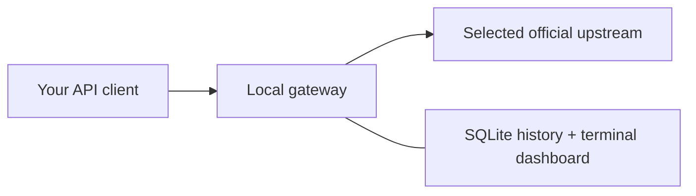

# ChatGPT Plan Gateway

[简体中文](README.zh-CN.md) · [Configuration](docs/configuration.md) · [Verification](docs/offline-verification.md)

Use your own ChatGPT subscription or OpenAI API key through a local, OpenAI-compatible API. The gateway queues requests, controls send rate, records token usage, and shows it in a Chinese/English terminal dashboard.

Works with OpenAI SDKs, LiteLLM and ordinary HTTP clients. LOTUS and agent-memory are optional examples.



**Experimental · local use · MIT.** Default startup is offline. Small subscription checks passed; real rate-limit recovery and long-running reliability remain unverified.

## Quick start

Requires **Node.js 26+** and npm. No Docker, database service or global tools.

```bash
npm ci --ignore-scripts --cache .npm-cache
npm start
```

In another terminal, open the dashboard or send one offline request:

```bash
npm run status -- --lang en
# Or:
node examples/client.mjs
```

The server listens on `127.0.0.1:8787`. The offline fixture returns `{"answer":2}` with fixed sample usage **58 input / 13 output / 71 total**; it does not answer arbitrary prompts or measure their tokens.

## Choose an upstream

| Mode                   | What you provide           | What it uses               |
| ---------------------- | -------------------------- | -------------------------- |
| `offline` — default    | Nothing                    | Local fixture              |
| `chatgpt-subscription` | Your ChatGPT authorization | Eligible plan usage        |
| `openai-api-key`       | Your `OPENAI_API_KEY`      | API credits / paid balance |

### ChatGPT subscription

Replace `YOUR_MODEL` with a model available to your account. On first use:

```bash
npm run local -- init --model YOUR_MODEL
npm run auth -- login --config data/local/gateway.json
npm run local -- start
```

Login prints the official authorization URL. Later, run only `npm run local -- start`: saved authorization is reused and expiring tokens renew before requests. Login, initialization and startup send no model requests. This tool uses its own credentials, separate from Codex.

### OpenAI API key

On a fresh profile, with `OPENAI_API_KEY` already set in the server environment:

```bash
npm run local -- init --model YOUR_MODEL --upstream openai-api-key
npm run local -- start
```

The gateway does not save the upstream API key. [Eligible API credits](https://developers.openai.com/api/docs/guides/chatgpt-api-credits) use this route too; purchased balance may be used after free credits run out. The gateway cannot identify which credit pool was charged.

Local setup creates private `data/local/gateway.json` and `client.key`. Repeated initialization reuses a matching profile; conflicting settings fail without overwriting it. See [configuration](docs/configuration.md) for changing an existing profile or using custom configs.

## Monitor and connect

With the local service running, use a separate terminal:

```bash
npm run local -- status --lang en
npm run local -- status --once
npm run --silent local -- status --json
```

The dashboard shows queue/dispatch state, budgets, token details and request history. Arrow keys select, Enter opens details, and Q exits the monitor. Ctrl-C in the **server** terminal stops the gateway. See [dashboard controls](docs/status.md).

These examples read the saved address, model and local client key:

```bash
node examples/client.mjs --local
python3 -B examples/client.py --local
/path/to/existing/venv/bin/python -B examples/litellm_client.py --local
```

**Client examples send real requests when the selected upstream is real.** Monitoring does not. Python examples use your existing packages; nothing is installed automatically.

For other clients:

| Setting  | Value                                                     |
| -------- | --------------------------------------------------------- |
| Base URL | `http://127.0.0.1:8787/v1` — use your configured port     |
| API key  | Local `data/local/client.key`, not an upstream credential |
| Model    | The configured model; LiteLLM uses `openai/<model>`       |
| Retries  | Set to `0` in the client too                              |

Supported route: `POST /v1/chat/completions`. `GET /v1/models` lists the configured model, not your account's catalog. Keep loopback traffic out of environment proxies; the included local examples do this explicitly. [LiteLLM guide →](docs/litellm-integration.md)

API-key users can instead run the JavaScript/Python SDK examples with `--direct`, `MODEL` and `OPENAI_API_KEY`. Direct calls bypass the gateway's scheduling, history and dashboard. `--local` and `--direct` cannot be combined.

## Behavior and limits

- **Text and JSON:** text messages, one completion, JSON object/schema validation, non-streaming client responses. No tools, images or embeddings.
- **Explicit protocols:** subscriptions use official Responses; API keys use official Chat Completions. No added agent prompts, project files, implicit history, JSON repair calls or billing fallback. Unsupported parameters fail under the default `strict` policy; the optional LOTUS profile records omissions. See the [protocol](docs/protocol.md).
- **Bounded dispatch:** configurable concurrency and send spacing; defaults are **1** concurrent task and a **3-second** minimum interval in real modes. Optional smooth RPM cap, per-run request/token budgets, and **zero automatic retries**. Already-sent calls can take observed tokens past a stop threshold.
- **Upstream feedback:** recognized temporary limits with reliable hints delay unsent work; failed calls are never resent. Quota, balance, permission and unknown failures pause dispatch. Restarting resets local controls, not official limits.
- **Observed usage:** input/output/total come from the server. Missing cache/reasoning details stay unknown; subsets are not counted twice. Account balance and actual cost remain unknown.

Concurrency 1 can still hit official RPM/TPM limits, which other applications may share. This tool controls only its own traffic and cannot guarantee avoidance of rate limits or account enforcement. [Official rate limits →](https://developers.openai.com/api/docs/guides/rate-limits)

## Private local data

Real model and monitoring routes require a separate local bearer key and matching loopback Host/Origin. The service binds only to `127.0.0.1`; remote/shared hosting is not implemented.

Credentials use owner-only storage: directory `0700`, files `0600`. `data/`, `reports/`, environment files and caches are Git-ignored. Ordinary history omits prompt/output bodies; raw usage and metadata can still be sensitive. See [security](SECURITY.md) and [authorization](docs/authorization.md).

## Validation

```bash
npm run typecheck
npm run build
npm test
```

The **119-test offline suite** blocks non-loopback networking; POSIX terminal tests also require Python 3.9+. Optional [LiteLLM](docs/litellm-integration.md) and [LOTUS/SDK](docs/lotus.md) checks use existing Python environments.

Bounded live checks covered subscription text/JSON, usage, restart reuse, renewal, LiteLLM and LOTUS. The latest two-request run observed concurrency **2** with sends **3.003 seconds** apart. API-key serving and limit recovery have offline coverage only. Hosted CI is pending. [Evidence, failures and remaining limits →](docs/offline-verification.md)

## Documentation

| Topic                    | Guide                                                                                                                                                                            |
| ------------------------ | -------------------------------------------------------------------------------------------------------------------------------------------------------------------------------- |
| Protocol and credentials | [API contract](docs/protocol.md) · [Authorization](docs/authorization.md)                                                                                                        |
| Settings and monitoring  | [Configuration · 中文](docs/configuration.md) · [Dashboard · 中文](docs/status.md)                                                                                               |
| Client examples          | [LiteLLM · 中文](docs/litellm-integration.md) · [LOTUS](docs/lotus.md) · [agent-memory · 中文](docs/agent-memory-example.md)                                                     |
| Project status           | [Verification](docs/offline-verification.md) · [TODO · 中文](TODO.md) · [Troubleshooting](docs/troubleshooting.md)                                                               |
| Further reading          | [Remote-use proposal · 中文](docs/remote-use.md) · [Bounded probe](docs/live-probe.md) · [Fixture provenance](fixtures/README.md) · [Publication review](docs/privacy-review.md) |

Implemented against [OpenAI's public documentation for open-source/local apps](https://developers.openai.com/siwc/token-sharing-open-source), including its [preview restrictions](https://developers.openai.com/siwc/token-sharing-open-source/preview-limitations). This is an independent project, not an OpenAI-certified product; eligibility and upstream terms still apply.

[MIT License](LICENSE). Dependencies retain their own licenses.
