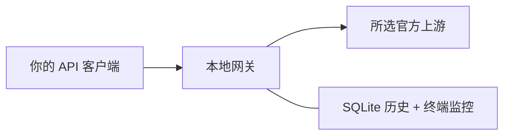

# PlanValve

[English](README.md) · [配置](docs/configuration.md) · [验收记录](docs/offline-verification.md)

PlanValve 是一个兼容 OpenAI 接口的本地网关，通过 OpenAI 官方的 [Sign in with ChatGPT](https://developers.openai.com/siwc/token-sharing-open-source/sign-in) 接入你自己的 ChatGPT 订阅，也支持 OpenAI API Key。它负责请求排队、限速和 token 用量统计，并提供中英文终端仪表盘。

普通 OpenAI SDK、LiteLLM 和 HTTP 客户端都能接入。LOTUS／agent-memory 是可选案例，不是网关依赖。



**实验原型 · 本机使用 · MIT。**默认离线。订阅通道已有小规模真实验证；真实限流后的恢复和长期稳定性仍未验证。

## 快速开始

需要 **Node.js 26+** 和 npm，不需要 Docker、数据库服务或全局工具。

```bash
npm ci --ignore-scripts --cache .npm-cache
npm start
```

另开终端，查看仪表盘，或发一次离线请求：

```bash
npm run status
# 或：
node examples/client.mjs
```

服务只监听 `127.0.0.1:8787`。离线样本固定返回 `{"answer":2}`，用量固定为**输入 58／输出 13／总计 71**；不会回答任意问题或测量你的 prompt 长度。

## 选择上游

| 模式                   | 你提供什么              | 消耗什么              |
| ---------------------- | ----------------------- | --------------------- |
| `offline`，默认        | 无                      | 本地模拟数据          |
| `chatgpt-subscription` | 自己的 ChatGPT 授权     | 获准使用的计划额度    |
| `openai-api-key`       | 自己的 `OPENAI_API_KEY` | API credits／付费余额 |

### 使用 ChatGPT 订阅

将 `YOUR_MODEL` 换成自己账号有权限使用的模型。首次使用：

```bash
npm run local -- init --model YOUR_MODEL
npm run auth -- login --config data/local/gateway.json
npm run local -- start
```

登录命令会打印官方授权网址。以后只需 `npm run local -- start`：复用已保存的授权，令牌临近过期时在请求前续期。登录、初始化和启动都不发送模型请求；凭证由本工具独立保存，不读取日常 Codex 凭证。

### 使用 OpenAI API Key

首次初始化前，在服务环境设置好 `OPENAI_API_KEY`：

```bash
npm run local -- init --model YOUR_MODEL --upstream openai-api-key
npm run local -- start
```

网关不保存上游 API Key。[符合条件的 API credits](https://developers.openai.com/api/docs/guides/chatgpt-api-credits) 也走这条通道；赠送额度耗尽后，平台可能继续使用充值余额。网关无法判断某次调用具体扣了哪类余额。

本机配置和独立访问 Key 位于私有的 `data/local/gateway.json`、`client.key`。重复初始化相同配置会原样复用；冲突时报错，不覆盖。修改已有配置或使用自定义配置，见[配置说明](docs/configuration.md)。

## 监控与客户端

网关运行后，在另一个终端执行：

```bash
npm run local -- status
npm run local -- status --lang en
npm run local -- status --once
npm run --silent local -- status --json
```

仪表盘显示排队／派发状态、预算、token 细分和历史。上下键选择，Enter 看详情，Q 退出监控；在**网关终端**按 Ctrl-C 才停止服务。详见[操作说明](docs/status.md)。

客户端示例直接读取已保存的地址、模型和本地 Key：

```bash
node examples/client.mjs --local
python3 -B examples/client.py --local
/path/to/existing/venv/bin/python -B examples/litellm_client.py --local
```

**选了真实上游，这些客户端命令就会发送真实请求。**监控不会。Python 示例使用已有环境，本项目不自动安装 Python 依赖。

其他客户端按下表连接：

| 设置     | 内容                                         |
| -------- | -------------------------------------------- |
| Base URL | `http://127.0.0.1:8787/v1`，端口按实际配置   |
| API key  | 本地 `data/local/client.key`，不是上游凭证   |
| 模型     | 与网关配置一致；LiteLLM 使用 `openai/<模型>` |
| 重试     | 客户端也设为 `0`                             |

调用接口为 `POST /v1/chat/completions`。`GET /v1/models` 只列配置的模型，不查询账号模型目录。本机流量应排除系统代理；所附本机示例已显式处理。[LiteLLM 接入指南 →](docs/litellm-integration.md)

API Key 用户也可以给普通 JavaScript／Python SDK 示例加 `--direct`，并设置 `MODEL`、`OPENAI_API_KEY`。直连会绕过网关的调度、历史和监控；不能同时使用 `--local`。

## 运行规则

- **文本与 JSON：**文本消息、一条 completion、JSON object／schema 校验、非流式客户端响应。不支持工具、图片或 embeddings。
- **明确的协议转换：**订阅使用官方 Responses，API Key 使用官方 Chat Completions。不增加 agent 提示词、项目文件或隐式历史，不额外调用模型修 JSON，不切换计费。默认 `strict` 拒绝不支持的参数；可选 LOTUS 策略会记录省略。见[协议说明](docs/protocol.md)。
- **有界发送：**并发和发送间隔可配置，默认并发 **1**、真实模式最短间隔 **3 秒**。可选平滑 RPM 上限、每次运行的请求／token 预算，**自动重试为 0**。在途请求仍可能使最终用量超过 token 停止阈值。
- **上游反馈：**明确临时限流且有可靠等待提示时，未发送任务等待后继续，失败请求不补发。额度、余额、权限及未知错误暂停派发；重启不恢复官方额度。
- **真实用量：**输入／输出／总量来自服务端，缓存／推理细分缺失时保留未知，不重复加进总量。账号余额和实际费用保持未知。

并发 1 仍可能触发官方 RPM／TPM 限制，其他程序也可能共享额度。本网关只控制经过自己的流量，不能保证避免限流或账号封控。[官方限流说明 →](https://developers.openai.com/api/docs/guides/rate-limits)

## 本机私有数据

真实模型及监控接口校验独立本地 Key 和 loopback Host／Origin。只绑定 `127.0.0.1`；未实现远程或共享托管服务。

凭证目录权限为 `0700`、文件 `0600`。`data/`、`reports/`、环境文件和缓存均被 Git 忽略。普通历史不保存 prompt／输出正文，但原始 usage 和 metadata 仍可能敏感。见[安全说明](SECURITY.md)与[授权管理](docs/authorization.md)。

## 验证

```bash
npm run typecheck
npm run build
npm test
```

**119 项离线测试**拦截非 loopback 网络；POSIX 终端测试另需 Python 3.9+。可选 [LiteLLM](docs/litellm-integration.md) 和 [LOTUS／SDK](docs/lotus.zh-CN.md) 验收复用已有 Python 环境。

已完成的小规模真实验证覆盖订阅文本／JSON、usage、重启复用、续期、LiteLLM 和 LOTUS。最新两请求实测在途 **2**、发送间隔 **3.003 秒**。API Key 通道及限流恢复只有离线验收；托管 CI 待处理。[证据、失败与限制 →](docs/offline-verification.md)

## 文档

| 内容       | 入口                                                                                                                                          |
| ---------- | --------------------------------------------------------------------------------------------------------------------------------------------- |
| 使用与接口 | [配置](docs/configuration.md) · [终端监控](docs/status.md) · [协议](docs/protocol.md) · [授权](docs/authorization.md)                         |
| 客户端案例 | [LiteLLM](docs/litellm-integration.md) · [LOTUS](docs/lotus.zh-CN.md) · [agent-memory](docs/agent-memory-example.md)                          |
| 项目状态   | [验收记录](docs/offline-verification.md) · [TODO](TODO.md) · [排错](docs/troubleshooting.md)                                                  |
| 补充资料   | [跨机器方案](docs/remote-use.md) · [独立 probe](docs/live-probe.md) · [fixture 来源](fixtures/README.md) · [发布检查](docs/privacy-review.md) |

依据 [OpenAI 面向开源／本地应用的公开文档](https://developers.openai.com/siwc/token-sharing-open-source)及其[预览限制](https://developers.openai.com/siwc/token-sharing-open-source/preview-limitations)实现。本项目独立维护，并非官方认证产品；资格与上游条款仍适用。

[MIT 许可证](LICENSE)。依赖保留各自许可证。
