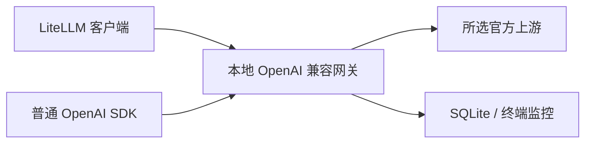

# LiteLLM 接入通用网关

本项目提供本地 OpenAI 兼容接口，将客户端请求转发到所选官方上游，并统一排队、预算、usage、SQLite 历史与终端监控。LiteLLM 是重点验收的客户端之一，不是网关运行依赖。普通 OpenAI SDK 使用同一接口。



LOTUS／agent-memory 属于 [外部使用案例](agent-memory-example.md)，不决定核心功能或开发顺序。跨机器方案单独放在 [部署设计](remote-use.md)，待办放在 [TODO](../TODO.md)。

## 连接配置

### 日常使用：读取已有本机配置

已有本机配置时，启动网关后直接运行 [LiteLLM 示例](../examples/litellm_client.py)：

```bash
# 使用已安装 LiteLLM 的现有 Python 环境，从网关项目根目录执行：
/path/to/existing/venv/bin/python -B examples/litellm_client.py --local
```

命令会实际发送一条 JSON 请求并打印文本、服务端 usage。无需设置下表里的环境变量或复制 Key：示例复用 `examples/client.py` 的受保护配置读取函数，读取 `data/local/gateway.json` 和 `client.key`。不读取上游授权文件，不自动打开浏览器，也不导入 LOTUS／AM。

它把禁用代理／重定向、零重试的官方 SDK client 交给 LiteLLM 使用，LiteLLM 自身也设零重试；因此这个示例不依赖 `NO_PROXY` 才能绕过系统代理。缺失 `--local` 或传入其他参数时，先显示用法并退出，不加载模型库或读取 Key。普通初始化与网关启动见 [本机快速开始](../README.zh-CN.md)。

### 自己的 LiteLLM 程序：显式连接参数

| 客户端设置 | 内容 |
| --- | --- |
| LiteLLM model | `openai/<网关配置的模型>` |
| api_base | `http://127.0.0.1:8787/v1`，端口与实际服务一致 |
| api_key | 网关本地访问 Key，不是订阅令牌或上游 API Key |
| num_retries | 0，失败不重发 |
| 输出 | 文本、JSON object 或 JSON schema；客户端非流式 |
| 代理 | `NO_PROXY` 和 `no_proxy` 均包含 `127.0.0.1,::1` |

`openai/` 选择 OpenAI 兼容协议，不意味着绕过网关，也不选择 LiteLLM 的 `chatgpt/` provider。订阅还是 API Key 通道由网关的 `upstream` 决定。

启动和监控继续使用已有入口：

```bash
npm run local -- start
# 另一个终端：
npm run local -- status
```

客户端单独配置 `MODEL` 和 `GATEWAY_LOCAL_API_KEY`；从受保护的本机文件读取 Key，不打印，不写入源码、命令参数或共享文档。`MODEL` 不带 `openai/`，下面代码会添加前缀。日常本机配置和 Key 的存放方式见 [快速开始](../README.zh-CN.md)。

```python
import os
import litellm

response = litellm.completion(
    model=f"openai/{os.environ['MODEL']}",
    api_base="http://127.0.0.1:8787/v1",
    api_key=os.environ["GATEWAY_LOCAL_API_KEY"],
    messages=[{"role": "user", "content": "Reply exactly: OK"}],
    num_retries=0,
)
print(response.choices[0].message.content)
print(response.usage)
```

这段示例连接真实服务时会发送模型请求，不是初始化命令。只传网关支持的参数；LiteLLM 支持的工具、图片或流式能力，不代表网关也已实现。

## 参数和 usage

默认 `strict` 拒绝不支持的参数。只包含受支持字段的直接 LiteLLM 请求无需选择特殊兼容策略；`lotus` 是外部客户端需要时显式选择的可选策略。订阅通道省略温度、输出上限等参数时，会记录省略，不能声称这些设置生效。API Key 通道在支持范围内保留标准参数。

输入、输出、总量取自服务端 usage。缓存是输入子集、推理是输出子集，不重复加入总量；缺失细分保持未知。额外的原始字段保存在网关记录中，不保证全部透传到客户端响应。累计 token 预算不等于单次输出硬上限，也不等于账号余额或费用。

网关只调度经过自己的流量。并发默认 1、可配置；本地 RPM 可选，其他应用可能共享官方限制。明确临时错误有可靠提示时，后续未发送任务等待后继续，失败请求不补发；额度、余额、权限等硬暂停不会自动恢复。客户端也须关闭自己的重试。详见 [协议](protocol.md)。

## 独立离线验收

独立验收入口使用现有 Python 环境中的 LiteLLM，直接调用真实本地 HTTP 网关；模拟上游，不读取真实授权，不导入 LOTUS 或 agent-memory，也不安装依赖：

```bash
GATEWAY_LITELLM_PYTHON=/path/to/existing/venv/bin/python npm run test:litellm
```

12 个离线场景已通过：文本、JSON object、JSON schema、非零和缺失 usage 细分、参数拒绝、失败／限流／断流／缺失 usage 不重发，以及带系统代理环境的 loopback 直连。共 12 条本机 HTTP 请求、11 次模拟上游调用，代理请求为 0。Node 与 Python 均限制外部网络，Python 禁止向项目外写入并禁用字节码与 dotenv 自动发现。实际结果与运行命令分别记录在 [验收文档](offline-verification.md)；此入口不属于默认 CI 的必备 Python 依赖。

## 已授权的真实小请求

2026-11-06，`examples/litellm_client.py --local` 通过已保存的订阅授权完成一条真实请求，返回 `{"answer":2}`。服务端 usage 为输入 15、输出 12、总计 27，缓存／推理／cache-write 均明确为 0；客户端、原始 usage、网关记录和 SQLite 一致。只有一条客户端请求和一条模型请求，零重试；复用授权并自动续期一次，没有网页登录。这发生在本轮调度改造前，不用它证明新版并发行为。

真实长期运行、其他模型权限和跨机器部署不由模拟结果代替。LOTUS／研究仓库的完整链路另外验收，不作为通用网关可用的前提。
