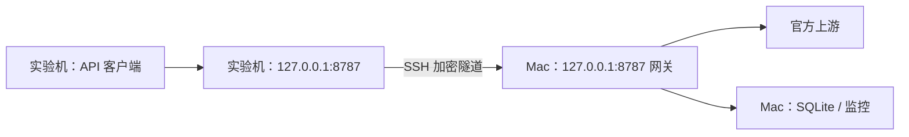

# 跨机器使用设计

更新：2026-11-06。这是适用于普通 API 客户端的部署设计，与 LiteLLM、LOTUS 或具体研究仓库无关；尚未配置或验收。当前实现仍只监听 loopback。客户端接入见 [LiteLLM 指南](litellm-integration.md)，工作状态见 [TODO](../TODO.md)。


### A. 网关留在 Mac，实验在另一台机器运行

优先考虑这个方案，因为授权、续期、队列和 SQLite 都只有一个管理进程。**这是待验证的个人设备网络方案，不是当前已支持的部署承诺**；当前安全说明仍将服务限定为本机使用，不直接开放或分享端口。见 [安全说明](../SECURITY.md)。



后续验证时，从实验机建立 SSH 本地转发。前提是实验机已获准连接 Mac 的 SSH，实际用户名和主机名由使用者填写；本轮不启用远程登录、不修改防火墙或 SSH 设置。命令只展示形状，尚未执行：

```bash
ssh -N -T -o ExitOnForwardFailure=yes \
  -L 127.0.0.1:8787:127.0.0.1:8787 MAC_USER@MAC_HOST
```

实验客户端仍用 `http://127.0.0.1:8787/v1`。隧道只转发 TCP，不改 HTTP Host；当前网关校验 Host 必须与实际监听端口一致，所以两端都用 8787。若实验机该端口占用，先处理端口规划，不能随意只换一侧端口。此处是依据现有 Host／Origin 校验和 [OpenSSH 本地转发语义](https://man.openbsd.org/ssh.1#L) 作出的设计推断，尚未实测。

实验机只需要模型、地址和本地访问 Key，不复制订阅令牌、授权目录或数据库；也不能直接使用依赖 Mac 本机文件的 `local_connection()`。本地 Key 同时有模型调用和监控读取权限，因此这里只考虑同一使用者控制的实验机。密钥传递／保存方式在真正部署时明确，不能写入提交、命令参数或日志。

如已有可达的 SSH，不需要 Tailscale。若两台机器不便直连，可考虑 **Tailscale 组网加普通 OpenSSH**，仍让 HTTP 留在 loopback，不直接把 API 地址改成 Tailscale IP。网关和监控当前会拒绝这种直接远程地址。Tailscale SSH 是另一个功能；其 macOS 服务端有额外运行方式要求，不能与普通 SSH 混为一谈。参见 [Tailscale 官方对比](https://tailscale.com/docs/features/tailscale-ssh)。

Mac 睡眠、隧道中断会影响实验。断连后某个已发送请求可能仍在 Mac 完成，先查网关记录再决定下一步，不能自动补发。多个客户端共用一个网关时仍只有一个串行队列和本次运行预算，尚无按客户端分账；这是后续是否需要增加功能的实际依据。

监控优先仍在 Mac 上运行。将来若在实验机查看，可考虑经同一个隧道使用底层 `status --url` 入口和同一个本地 Key；不是复制整套 `data/local` 配置，且需要验证 Host、权限和断连行为。

### B. 网关也搬到实验机／自己的 VM

适合长期运行、希望摆脱 Mac 睡眠和隧道依赖的情景；它是另一个部署阶段。API Key 通道可以只在服务机配置上游 Key，实验客户端继续使用独立本地 Key。

订阅通道有 [OpenAI 官方自托管 VM 指南](https://developers.openai.com/siwc/token-sharing-open-source/self-hosted-vms)：为 VM 保留独立稳定 host ID，经安全通道迁移所选会话，并由 VM 管理后续刷新。官方也说明，同一用户／workspace 可在多个 host 复用 client 注册，每个 host 的 ID 应不同；这不等于可以让多个进程并行刷新同一个轮换令牌。见 [官方概述](https://developers.openai.com/siwc/token-sharing-open-source)。

**本项目尚未实现这种凭证导入／迁移入口。**不要直接复制现有 session 文件后让两台机器同时使用：现有锁只保护本机进程，不能协调不同机器。迁移需要明确唯一的会话刷新拥有者、保留目标 host ID、保护文件权限并验证身份；不预先引入分布式锁或账号池。官方目前也提示，迁移会话的按 host 用量归因／撤销存在预览限制。

因此，个人自托管 VM 不是一概不支持；向别人运营付费或远程托管应用则是另一范围，官方概述给出了单独的申请路径。不能把网络连通当作全部接入要求已经满足，也不据此保证永不封控。
